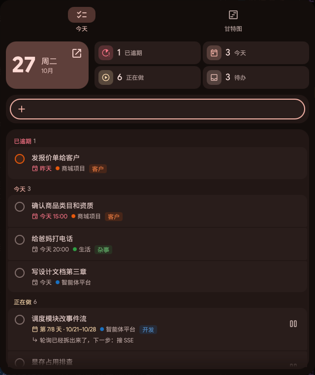
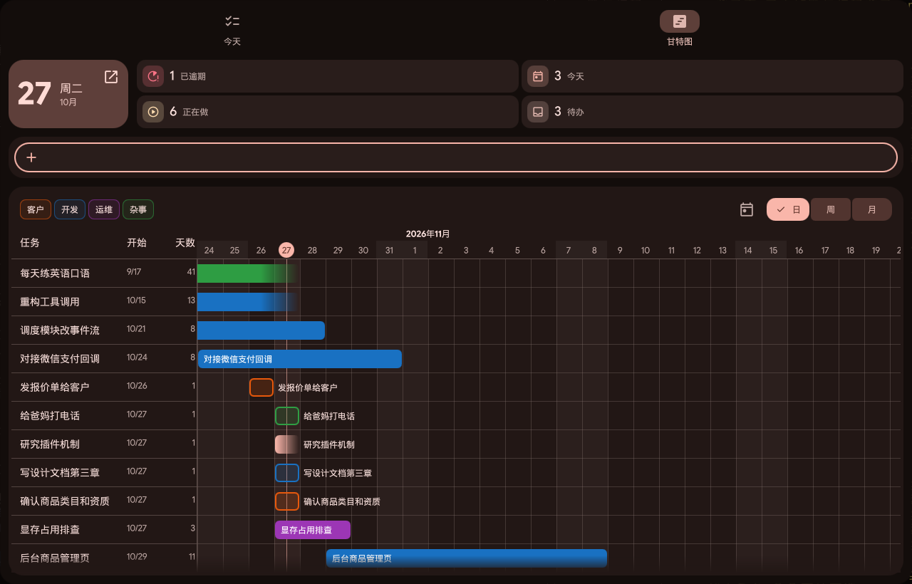

# dms-daiban

> 给 [DankMaterialShell](https://github.com/AvengeMedia/DankMaterialShell)（niri / Hyprland 桌面）做的待办面板。
> 多线程干活时随手记、随时看"我现在在做什么"。数据存在自部署的 [Vikunja](https://vikunja.io)。

按 `Mod+D` 弹出"今天"面板——和 DMS 自带的 `Mod+Space`、DankDash 是同一套组件、同一套配色，原生刷新率。

| 今天 | 甘特图 |
|---|---|
|  |  |

## 功能

- **分组**：已逾期 → 今天 → 正在做 → 待办，底部可展开"今天已完成"（点勾恢复，防误触）
- **待办 / 正在做**：新加的任务默认没有截止，进"待办"；点 ▶ 开始做，自动排期 N 天（默认 3 天，可改），显示"第 2/3 天"，到期没做完标"超出计划"；点 ⏸ 放回待办
- **做到哪了**：任务备注的第一行直接显示在任务下面，切回来一眼就知道进度
- **快速添加**：直接打字回车；也认 `明天下午3点 改报价 !3 +项目 *标签` 这种写法（截止、优先级、项目、标签）
- **编辑**：点任务从右侧滑出编辑页，截止日期用月历点选
- **甘特图**：日/周/月缩放、按标签筛选；拖横条平移、拖两端改起止；长期在做的任务画到今天并渐隐
- **顶栏按钮**：显示今天还剩几件（逾期标红），左键开面板、右键直达甘特图
- **时区**：按 Vikunja 账号的时区算"今天"，和系统时区无关

## 组成

```
dms-daiban/
├── dms-plugin/   DMS 插件（QML）：Mod+D 面板、编辑页、甘特图、顶栏按钮 —— 日常用这个
├── app/          Flutter 客户端：完整应用（多页面、设置），以后出手机版
├── server/       Vikunja 部署模板（Podman Quadlet）
├── niri/         快捷键、窗口规则片段
├── scripts/      安装脚本、登录脚本、完整应用启动脚本
└── docs/         截图
```

```
 Mod+D ─▶ DMS 插件 (QML) ──┐
                            ├──▶ Vikunja REST API ──▶ SQLite
 Mod+Shift+D ─▶ Flutter 应用 ┘        (Podman, :3456)
```

插件和 Flutter 应用都只是客户端，数据都在 Vikunja 里，以后 Hermes 之类的助手也可以直接读写同一份数据。

## 部署

需要：Fedora / Arch 等 Linux，niri（或其他 DMS 支持的合成器），DankMaterialShell ≥ 2.0，Podman，Python 3.11+。

### 1. 后端：Vikunja

```bash
scripts/install-server.sh            # 数据默认放 ~/.local/share/vikunja，可传别的目录
```

会生成带随机密钥的配置、装成 systemd 用户服务（开机自启）。打开 http://localhost:3456 注册账号。
要让手机等局域网设备访问，把数据目录里 `vikunja.env` 的 `VIKUNJA_SERVICE_PUBLICURL` 改成本机局域网 IP，再 `systemctl --user restart vikunja`。

### 2. 插件凭据

```bash
scripts/daiban-login.py              # 或 scripts/daiban-login.py http://服务器:3456
```

用账号密码登录一次，生成一个只有任务/标签/项目权限、有效期一年的 API token，写到 `~/.config/vikunja-md/dms.json`（仅本人可读）。插件不保存密码。

### 3. DMS 插件

```bash
scripts/install-plugin.sh
```

然后在 DMS 设置 → 插件 里启用"待办"，需要的话把它加到顶栏。

### 4. 快捷键（niri）

在 `~/.config/niri/config.kdl` 里加一行：

```kdl
include "/path/to/dms-daiban/niri/daiban.kdl"
```

- `Mod+D`：今天面板（`dms ipc call daiban toggle`）
- `Mod+Shift+D`：完整应用

其他合成器绑定 `dms ipc call daiban toggle` 即可。可用的 IPC：`toggle` / `open` / `close` / `gantt` / `edit <任务ID>`。

### 5. 完整应用（可选）

```bash
cd app
tool/build-linux.sh                  # 需要 Flutter 3.47+、clang、gtk3-devel、gtk-layer-shell-devel
```

`scripts/install-plugin.sh` 已经装好了 `~/.local/bin/daiban`（Mod+Shift+D 调它）。完整应用第一次打开时登录；它也会自动维护上面的 `dms.json`。

## 开发

- 插件代码在 `dms-plugin/`，改完运行 `scripts/install-plugin.sh`（复制到 `~/.config/dms/plugins/Daiban` 并重启 DMS）
- 日期解析测试：`node dms-plugin/tests/dates.test.mjs dms-plugin/Dates.js`；在 Qt 的 JS 引擎里再跑一遍见 `dms-plugin/tests/README.md`
- Flutter 应用：`cd app && flutter test`，界面截图用 `tool/shot.sh`（Xvfb，不打扰桌面）

踩过的坑：

| 现象 | 原因 / 做法 |
|---|---|
| 插件重载后报 `File name case mismatch` | `dms ipc call plugins reload` 给 URL 加了 `?revision=N`，同目录的 QML 类型解析出错。改用 `dms restart` |
| 插件目录不能用软链接 | Qt 会比对真实路径，同样报上面的错，所以安装脚本是复制 |
| 日期正则在 Qt 里永远匹配不上 | Qt 的 JS 引擎不支持后行断言 `(?<!…)`，不报错但不匹配 |
| 两个弹窗叠起来点不了 | DModal 都抢键盘、抢点击；编辑器做成面板里滑入的一页 |
| 下拉菜单点不到 | DDropdown 的选项菜单是单独弹窗，会落在 overlay 层弹窗下面；改用胶囊选择块 |
| 面板被全屏窗口挡住 | DModal 默认在 top 层，设 `useOverlayLayer: true` |
| Vikunja 更新任务后字段被清空 | 更新接口要整包提交，没传的字段会被清空 |
| Vikunja 登录 10 分钟就掉 | JWT 只有 10 分钟，refresh token 一次性且会轮换；插件改用长期 API token |
| Flutter Linux 只有 60 帧 | GTK3 帧时钟默认按 16.7ms 节流，见 `app/linux/runner/high_refresh_vsync.cc` |

## 许可

MIT，见 [LICENSE](LICENSE)。`app/linux/runner/flutter_embedder.h` 来自 Flutter 引擎（BSD-3-Clause），见 [NOTICE](NOTICE)。
